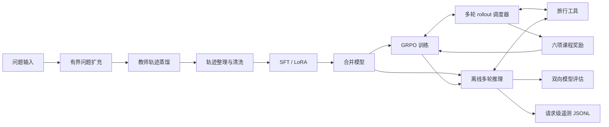

# 架构与数据流

VoyageRL 将旅行任务拆成“生成工具调用 → 获取外部信息 → 继续推理 → 输出答案”。模型训练由 ms-swift 承担；本仓库保留任务相关的工具、数据处理、推理循环和训练插件。

图中“轨迹整理”不是自动打通的生产流水线：蒸馏输出是逐样本 JSON，清洗入口要求 `conversations` JSONL，训练与推理使用的字段也不同，需要按任务准备和检查数据。

## 入口与边界

| 模块 | 职责 | 关键边界 |
| --- | --- | --- |
| `test_expand_50.py` | 从种子生成最多 50 条新问题 | 请求次数、连续无进展次数均有上限；运行需要模型服务 |
| `data_distill.py` | 使用教师模型生成工具交互轨迹 | 只跳过通过完整性校验的已完成样本；失败样本可再次运行 |
| `data_clean/format_filter.py` | 归一化工具调用并过滤坏轨迹 | 输入 `conversations`，默认过滤模式为 `empty_and_invalid` |
| `data_clean/quality_filter.py` | 基于模型判断质量并导出筛选集 | 判断依赖外部模型，不等同人工事实核验 |
| `run_tool_loop_infer.py` | 模型生成、解析、工具执行与终止 | 支持 Transformers 和 vLLM；超时/失败/重复调用需观察状态 |
| `training/plugins/tooluse_multi_turn_scheduler.py` | 将工具循环接入 ms-swift rollout | 从推理模块加载公共解析和执行辅助函数 |
| `training/plugins/tooluse_reward_parser_aligned.py` | 组合规则奖励与答案评审 | 复用解析器；依赖 ms-swift 插件接口和评审模型 |

## 工具协议

推理循环识别 `<tool_call>...</tool_call>` 中的调用载荷和 `<answer>...</answer>` 中的答案。解析、参数抽取和调用签名位于 `run_tool_loop_infer.py`，用于识别非法或重复调用。清洗模块将轨迹中的标签调用转换为 OpenAI 风格 `tool_calls`，并检查工具响应对应关系。

调度器复用推理模块的工具解析、答案判定、系统提示归一化及部分路线查询辅助逻辑，从结构上减少训练与部署使用两套协议的偏差。这种复用提高一致性，但不代表两个运行环境已经通过真实模型端到端等价验证。

| 工具名 | 来源与行为 |
| --- | --- |
| `weather_search`、`poi_search`、`around_search`、`route_planning` | 高德 Web 服务，需 `AMAP_MAPS_API_KEY` |
| `search` | 默认网页搜索实现及可替换提供方，需对应服务密钥 |
| `visit` | 网页抓取与提取；存在替代实现，依赖按所选模块配置 |
| `flights_search`、`train_tickets_search` | 调用模型生成模拟交通信息，没有实时票务库存 |

## 奖励设计

课程奖励由六项分量加权组成：过程协议、工具 schema、答案标签、阶段行为、工具使用效率、答案 LLM Judge。具体定义以 [奖励插件](../training/plugins/tooluse_reward_parser_aligned.py) 中各 `ParserAligned*Reward` 类为准。

[GRPO 启动脚本](../scripts/train_rl.sh) 默认把阶段比例设为 `0.15 / 0.20 / 0.65`，答案评审权重设为 `0.60 / 0.70 / 0.75`。脚本通过环境变量覆盖插件默认值，因此记录实验时必须保存最终配置，不能只抄插件默认参数。

规则奖励约束可执行格式，模型评审补充答案质量信号。它们仍可能出现格式正确但信息不实、重复调用被表面改写绕过、评审偏好等问题；是否改善规划能力必须通过独立测试集验证。

## 观测与运行形态

[RequestMetrics](../utils/inference_telemetry.py) 在请求结束时追加一行 JSONL，记录端到端、模型与工具耗时，以及工具调用数、错误数、轮次和输出 token 估算。日志不写提示词、回答正文或异常消息；写入失败不会中断推理。多进程应使用不同日志文件。

仓库没有应用服务器端口；训练 rollout 服务默认使用 `127.0.0.1:8000`。训练依赖 Linux / WSL Bash 和适配的 GPU 软件栈，公开版本未验证完整训练运行。
